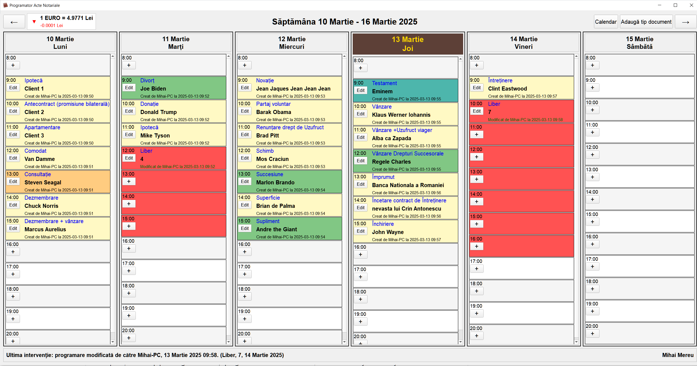

# 📅 Notary Scheduler

**The appointment book of a Romanian notary office, in daily use.**
A weekly calendar where the office staff book clients by type of notarial deed, from several computers on the same database, with every change written to an audit log.


*(Screenshot made with invented names: no real client data is ever stored in this repository.)*

**Tech:** Python · PyQt5 · SQLite · Requests / BeautifulSoup · PyInstaller · Docker (VNC)

---

## ✨ Features

### The week at a glance
- Monday to Saturday, hourly rows from 8:00 to 20:00, plus **appointments at any time** (e.g. 10:30), not only on the hour.
- Each appointment shows the deed type, the client and who created or last changed it, from which computer and when.
- Today's column is highlighted; jump to any date from a calendar, or move week by week.
- Holidays and recurring events can be managed separately and appear on the calendar.

### Deed types and colours
- A configurable list of deed types (mortgage, sale, inheritance, donation, will…), sorted alphabetically.
- Four configurable colours to group deed types at a glance.
- **Renaming a deed type updates every existing appointment** that uses it.

### Blocking time ("Liber")
- A *Liber* appointment blocks time in red.
- Type a number (1, 2, 3…) to block exactly that many consecutive slots; leave it empty to block the rest of the day.
- Blocking stops automatically at the next real appointment.

### Several computers, one book
- All workstations open the **same database** from a shared folder.
- A lock file prevents two computers from editing at the same time; locks older than 4 hours are treated as stale and cleared.
- **Audit log:** every insert, change and deletion is written to a monthly log file with the computer name. Deleted appointments are kept in the database with who deleted them and when; changes to notes are logged separately.
- A status line always shows the last change made in the book.

### Exchange rate
- The **EUR/RON exchange rate**, needed every day in a notary office, is fetched every hour in the background, with an arrow showing whether it went up or down.

---

## 🗂️ Code and data are separate

```
<root>/
├── Project/   this repository
└── Data/      notarial_scheduler.db, document_types.json, window_settings.json,
               interventii_YYYY_MM.log, notarial_scheduler.lock
```

- Running from source, data goes to `../Data`.
- Running as an `.exe` in the office, data stays **in the folder the program starts from**, so every workstation shares the same database on the network; if a `Data` folder exists next to the `.exe`, that one is used.
- `NOTARIAT_DATA_DIR` moves the data anywhere.
- `.gitignore` refuses databases, logs and settings a second time.

---

## 🚀 Getting started

```bash
git clone https://github.com/mmereu97/notary-scheduler.git Project
cd Project
pip install -r requirements.txt
python Programator.py
```

**Windows executable**
```bash
pip install pyinstaller
pyinstaller programator.spec
```
Put the `.exe` in a shared network folder; every workstation starts it from there.

**Docker** (the desktop app served over VNC)
```bash
echo VNC_PASSWORD=choose-one > .env
docker compose up --build
```
Then connect a VNC viewer to port 5900.

The interface is in Romanian.

---

## 👤 Author

Mihai Mereu · [GitHub](https://github.com/mmereu97)
